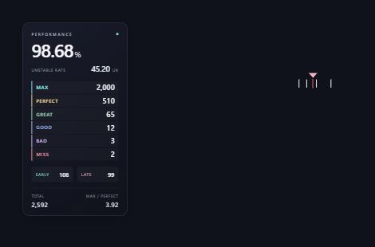

# Mania Helper

**made by 0naire**

osu!mania의 타이밍·정확도·세부 판정을 한곳에서 확인하는 Windows용 수동 실행 도우미입니다. 콤보 아래의 작은 삼각형·흰색 눈금과, 노트 레인 옆의 반투명 정확도 패널을 제공합니다.

## 주요 기능

- 실제 플레이의 빠른 입력·늦은 입력을 실시간으로 표시합니다.
- 최근 눈금만 짧게 남기고, 눈금이 과도하게 쌓이지 않도록 개수를 제한합니다.
- 가로 위치, 세로 위치, 눈금 범위와 **크기(50~220%)**를 메뉴에서 조절합니다.
- 현재 4K 스킨의 `ColumnStart`, `ColumnWidth`, `ComboPosition`을 읽어 위치를 맞춥니다.
- 프로그램 안의 미리보기에서 콤보와 눈금의 간격, 위치, 크기 변경이 바로 보입니다. 연결 중에는 실제 판정 눈금도 표시하며, 연결 전에는 예시 눈금을 보여 줍니다.
- 기본 위치를 콤보에 조금 더 가깝게 맞추고, 기본 크기를 120%로 조정했습니다.
- 옆 패널에 정확도, UR, MAX/PERFECT/GREAT/GOOD/BAD/MISS 개수, EARLY/LATE, 총 판정 수, MAX/PERFECT 비율을 표시합니다.
- 옆 패널은 따로 켜고 끌 수 있으며, 위치와 크기를 별도로 조절합니다. 프로그램 오른쪽에서 같은 색상과 숫자 구성을 미리 확인할 수 있습니다.
- **자동 시작을 등록하지 않습니다.** 직접 열고 ‘도우미 시작’을 누른 동안만 동작합니다.
- 시작 후에는 설정창을 트레이로 숨겨 게임 위의 표시만 남깁니다. 트레이 아이콘 더블클릭 또는 우클릭 → ‘설정 열기’로 다시 열 수 있습니다. ‘시작 후 설정창 숨기기’를 끄면 설정창을 유지합니다.
- ‘중지’ 또는 창 닫기로 연결 프로그램과 오버레이를 함께 종료합니다. osu! 자체는 종료하지 않습니다.

## 사용 방법

1. 이 저장소의 **Code → Download ZIP**으로 내려받고 압축을 완전히 풉니다.
2. `Setup.cmd`를 한 번 실행합니다. 공식 tosu 구성 요소 두 개를 내려받아 SHA-256을 확인한 후 준비합니다. 약 185MiB를 다운로드하며, 압축 해제 공간이 추가로 필요합니다.
3. osu!를 켜고 사용할 mania 스킨을 선택합니다.
4. `ManiaHelper.exe`를 직접 실행합니다.
5. **스킨에 맞추기 → 도우미 시작**을 누릅니다.
6. 프로그램 안의 미리보기를 보면서 가로·세로 위치, 눈금 범위와 크기를 조절합니다. ‘게임 메뉴에서도 미리보기’를 켜면 osu! 곡 선택 화면에서도 위치를 볼 수 있습니다.

창의 X를 누르거나 트레이 → ‘종료’를 누르면 도구도 종료됩니다. 최소화하면 트레이에서 계속 동작합니다. 게임 실행이나 Windows 로그인만으로 이 도구가 자동 실행되지는 않습니다.

## 판정 패널 읽기

MAX는 320 판정, PERFECT는 300, GREAT는 200, GOOD은 100, BAD는 50, MISS는 미스입니다. 정확도와 UR은 tosu가 읽은 게임 값을 사용합니다. TOTAL은 여섯 판정의 합, 비율은 MAX를 PERFECT로 나눈 값입니다. PERFECT가 0이면 비율은 `∞` 또는 `—`로 표시합니다.

EARLY/LATE는 게임에서 제공한 판정 오차 배열의 음수/양수 개수입니다. 정확히 0인 입력과 오차 데이터가 없는 미스는 포함하지 않으므로 TOTAL과 합이 다를 수 있습니다. 프로그램을 시작하기 전의 판정도 배열에 남아 있으면 집계합니다.

## 요구 사항과 범위

- Windows 10/11 64비트, .NET Framework 4.8.
- osu!stable의 mania를 대상으로 제작했으며, 현재 4K 스킨에 맞춰 기본 위치를 설정합니다. 다른 키 수와 특수 배치는 직접 조절하세요.
- 판정 데이터를 읽는 연결 부분과 전체화면 표시는 [tosu](https://github.com/tosuapp/tosu)를 사용합니다. 이 프로젝트는 연결 제어 메뉴와 작은 눈금 형태의 오버레이를 제공합니다.
- Windows 환경 및 다른 오버레이와의 조합에 따라 호환성이 달라질 수 있습니다. 게임과 도구의 실행 권한을 동일하게 맞추세요.
- 기존 tosu가 24050 포트를 사용 중이면 먼저 기존 tosu를 종료해야 합니다. 다른 실행 중인 tosu를 이 도구가 임의로 종료하지 않습니다.
- 기존 스킨과 게임 설정 파일을 수정하지 않습니다. 사용자별 설정은 도구 폴더의 `runtime/static/ZeroTimingBar/layout.json`에 저장됩니다.

## 직접 빌드

소스는 `source/ManiaHelper.cs`에 있습니다. Windows PowerShell에서 `powershell -NoProfile -ExecutionPolicy Bypass -File .\build.ps1`을 실행하면 같은 폴더에 실행 파일을 만듭니다. `Setup.cmd`는 구성 요소만 준비하며 프로그램을 자동 실행하지 않습니다. PowerShell 실행 정책은 해당 실행에만 적용합니다.

## 구성 요소와 제작자

- 메뉴·연결 제어·컴팩트 표시: **0naire**
- 데이터 연결 및 전체화면 오버레이: **[tosuapp/tosu](https://github.com/tosuapp/tosu)**, LGPL-3.0. 공식 릴리스 `v4.26.3`을 사용합니다.
- 판정 계산과 눈금 엔진: **[KapiWilq/HitErrorMeter](https://github.com/KapiWilq/HitErrorMeter)**, AGPL-3.0. 관련 원본 소스와 라이선스를 `runtime/static/ZeroTimingBar/vendor/`에 포함했습니다.

웹 오버레이는 위 AGPL 구성 요소를 사용하는 파생 작업으로 해당 조건을 따릅니다. 원저작자 표시는 `made by 0naire`와 별도로 유지합니다. `THIRD-PARTY-NOTICES.md`를 참고하세요.
